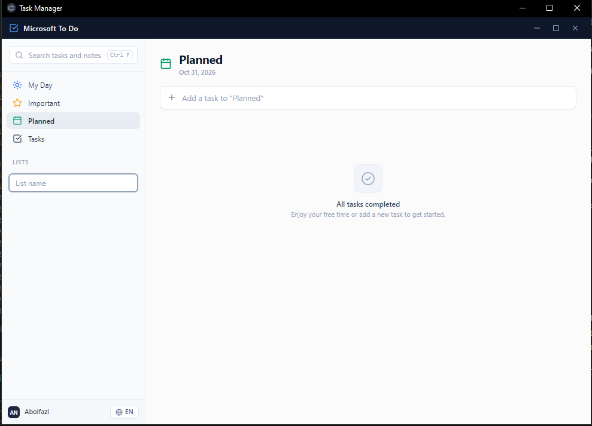

<div align="center">

  

  # Taskora

  **The minimal, offline-first task companion engineered for deep focus.**  
  *A distraction-free productivity application built with Clean Architecture, Electron, React 19, and TypeScript.*

  <br />

  <p align="center">
    <a href="https://github.com/almas77abolfazl/taskora/releases/download/v1.0.0/Taskora-Setup-1.0.0.exe">
      
    </a>
    &nbsp;&nbsp;
    <a href="https://github.com/almas77abolfazl/taskora/releases/download/v1.0.0/Taskora-1.0.0.exe">
      
    </a>
  </p>

  <br />

  [](https://github.com/almas77abolfazl/taskora/releases/latest)
  [](https://github.com/almas77abolfazl/taskora/releases/latest)
  [](LICENSE)

  <br />

  [](https://github.com/almas77abolfazl/taskora/actions)
  [](https://www.electronjs.org/)
  [](https://react.dev/)
  [](https://www.typescriptlang.org/)
  [](https://tailwindcss.com/)
  [](https://vitest.dev/)
  [](docs/adr/003-offline-first-atomic-file-storage.md)

</div>

<br />

---

## Application Showcase

<div align="center">
  
  <p align="center"><em>Taskora running natively on desktop — Minimalist UI, Smart Lists, Jalali / Gregorian support, and zero clutter.</em></p>
</div>

---

## Downloads

Standalone Windows binaries are available directly via GitHub Releases:

| Package | Target | Description |
| :--- | :--- | :--- |
| [**Taskora Setup 1.0.0 (.exe)**](https://github.com/almas77abolfazl/taskora/releases/latest) | Windows x64 | Full installer with start menu and desktop shortcuts |
| [**Taskora Portable 1.0.0 (.exe)**](https://github.com/almas77abolfazl/taskora/releases/latest) | Windows x64 | Standalone executable — runs anywhere without installation |
| [**All Release Assets & Logs**](https://github.com/almas77abolfazl/taskora/releases) | Multi-arch | Source code, checksums, and changelog history |

---

## Key Features

<table>
  <tr>
    <td width="50%" valign="top">
      <h3>100% Offline & Local Data Ownership</h3>
      <p>No mandatory accounts, no cloud dependencies, and zero tracking. All tasks, subtasks, notes, and custom categories reside strictly on your local disk using a crash-safe <strong>Atomic Sequential Storage Engine</strong> (<code>AtomicFileStorage</code>).</p>
    </td>
    <td width="50%" valign="top">
      <h3>Bilingual & Dual Calendar Engine</h3>
      <p>Instant one-click toggle between <strong>English (LTR)</strong> and <strong>فارسی (RTL)</strong>. Features tailored typography (<code>IRANYekanRegular</code> / <code>Vazirmatn</code>) and native dual-calendar support for <strong>Solar Hijri (Jalali)</strong> and Gregorian dates.</p>
    </td>
  </tr>
  <tr>
    <td width="50%" valign="top">
      <h3>Minimalist Design & Visual Clarity</h3>
      <p>Thoughtfully designed for calm and focus. Built with crisp vector Lucide SVG iconography, balanced spacing, curated color accents, and responsive micro-interactions without visual bloat.</p>
    </td>
    <td width="50%" valign="top">
      <h3>Hardened Desktop Security</h3>
      <p>Built in strict adherence to Electron security standards: <code>contextIsolation: true</code>, <code>nodeIntegration: false</code>. The renderer communicates exclusively via strongly-typed, sanitized IPC contracts over <code>contextBridge</code>.</p>
    </td>
  </tr>
  <tr>
    <td width="50%" valign="top">
      <h3>Keyboard-First Workflow</h3>
      <p>Quick-add tasks with <code>Ctrl + N</code>, search titles and notes with <code>Ctrl + F</code>, organize checklists with auto-saving inputs, and dismiss panels with <code>Esc</code> without leaving the keyboard.</p>
    </td>
    <td width="50%" valign="top">
      <h3>Harmonic Completion Audio</h3>
      <p>A subtle harmonic chime on task completion, synthesized entirely in-memory via the Web Audio API without external audio assets or network requests.</p>
    </td>
  </tr>
</table>

---

## Feature Tour

### 1. Smart Focus Lists
- **My Day (روز من):** Daily focus view that helps you prioritize what matters today.
- **Important (مهم):** Star high-priority deliverables with distinct visual accents.
- **Planned (برنامه‌ریزی‌شده):** Chronological timeline organizing scheduled deliverables with overdue indicators.
- **Tasks & Custom Lists:** Organize initiatives with custom categorized lists and color pips.

### 2. Task Inspector Drawer
Slide open any task to manage details:
- **Subtasks (Steps):** Break large tasks into actionable step checklists with auto-save on blur.
- **Due Date Presets:** One-click presets for *Today*, *Tomorrow*, and *Next Week*.
- **Auto-Saving Notes:** Distraction-free scratchpad for task context, thoughts, and technical details.

### 3. Local Profile & Workspace Settings
Click the user pill in the bottom sidebar:
- Customize your personal display name.
- View real-time task statistics (Total, Completed, Pending).
- Check local storage health and offline status.

---

## Keyboard Shortcuts

| Shortcut | Action | Description |
| :---: | :--- | :--- |
| <kbd>Ctrl</kbd> + <kbd>N</kbd> | **Quick Add** | Focuses the task creation input bar |
| <kbd>Ctrl</kbd> + <kbd>F</kbd> | **Global Search** | Searches across task titles, lists, and notes |
| <kbd>Enter</kbd> | **Submit** | Commits a new task title, subtask step, or list |
| <kbd>Esc</kbd> | **Dismiss** | Closes the task inspector drawer or clears active search |

---

## Clean Architecture & Engineering Standards

Taskora is engineered using **Hexagonal Clean Architecture** and **Domain-Driven Design (DDD)**:

```
src/
├── core/                        # Domain Layer (Pure TypeScript, Zero External Dependencies)
│   ├── domain/entities/         # Task, SubTask, TaskList domain models
│   ├── ports/                   # ITaskRepository, IListRepository interfaces
│   └── ipc/                     # Type-safe IPC channels & IElectronAPI contracts
│
├── infrastructure/              # Adapter Layer (File I/O & Persistence)
│   └── storage/
│       ├── atomic-file-storage.ts      # Thread-safe sequential write queue
│       ├── local-file-task-repository.ts
│       ├── local-file-list-repository.ts
│       └── in-memory-task-repository.ts
│
├── main/                        # Electron Main Process
│   ├── index.ts                 # Frameless window manager, app lifecycle & tray
│   └── ipc/register-handlers.ts # IPC dispatchers invoking core repository ports
│
├── preload/                     # Security Layer
│   ├── index.ts                 # Sanitized contextBridge exposure
│   └── index.d.ts               # Global Window.api TypeScript augmentation
│
└── renderer/                    # Presentation Layer (React 19 + Tailwind v4)
    ├── src/
    │   ├── components/          # TitleBar, Sidebar, TaskView, TaskDrawer, ProfileModal
    │   ├── context/             # TaskContext & reactive state management
    │   ├── i18n/                # Localization engine & Jalali date formatters
    │   ├── lib/                 # Web Audio sound engine & date utilities
    │   └── styles/              # Global styles, fonts & Tailwind CSS v4
    └── index.html
```

### Architecture Decision Records (ADRs)
- [ADR 001: Modern Stack (Vite + Electron + React 19)](docs/adr/001-modern-stack-vite-electron.md)
- [ADR 002: Strict Context Isolation & Type-Safe IPC Bridge](docs/adr/002-strict-context-isolation-and-ipc-bridge.md)
- [ADR 003: Offline-First Atomic File Storage](docs/adr/003-offline-first-atomic-file-storage.md)
- [ADR 004: Bilingual Localization (RTL/LTR) & Solar Hijri (Jalali) Engine](docs/adr/004-bilingual-rtl-ltr-and-jalali-engine.md)

---

## Getting Started

### Prerequisites
- [Node.js](https://nodejs.org/) (v22.x or later recommended)
- [pnpm](https://pnpm.io/) (v10 or later)

### Local Development
```bash
# Clone the repository
git clone https://github.com/almas77abolfazl/taskora.git
cd taskora

# Install dependencies using pnpm
pnpm install

# Run the Electron application with Vite Hot Module Replacement (HMR)
pnpm dev
```

### Automated Testing & Quality Checks
```bash
# Run unit & component test suites with Vitest (22/22 tests)
pnpm test

# Run tests in watch mode
pnpm test:watch

# Execute strict TypeScript compiler validation across Main, Preload & Renderer
pnpm run typecheck

# Build production bundles
pnpm run build

# Package standalone Windows installer (.exe) & portable binary
pnpm run build:win
```

---

## License

This project is open-source software licensed under the [MIT License](LICENSE).

Developed by **[Abolfazl Nasiri Almas](https://github.com/almas77abolfazl)**.
